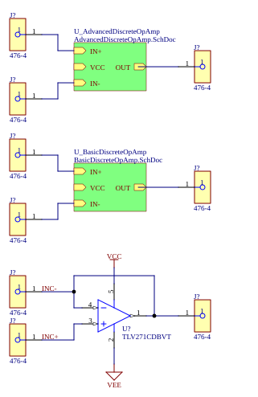
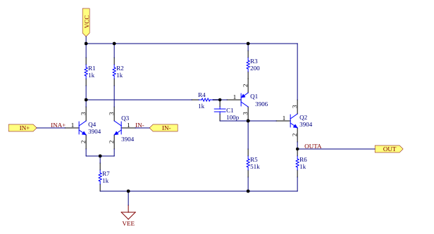
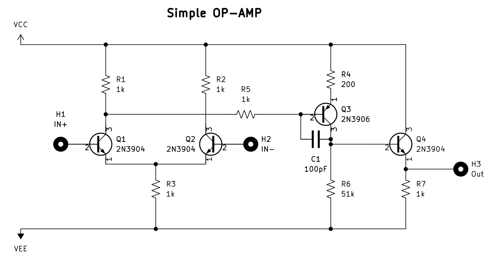
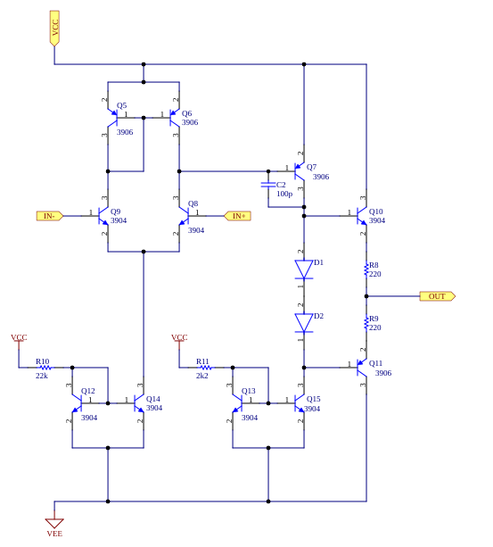
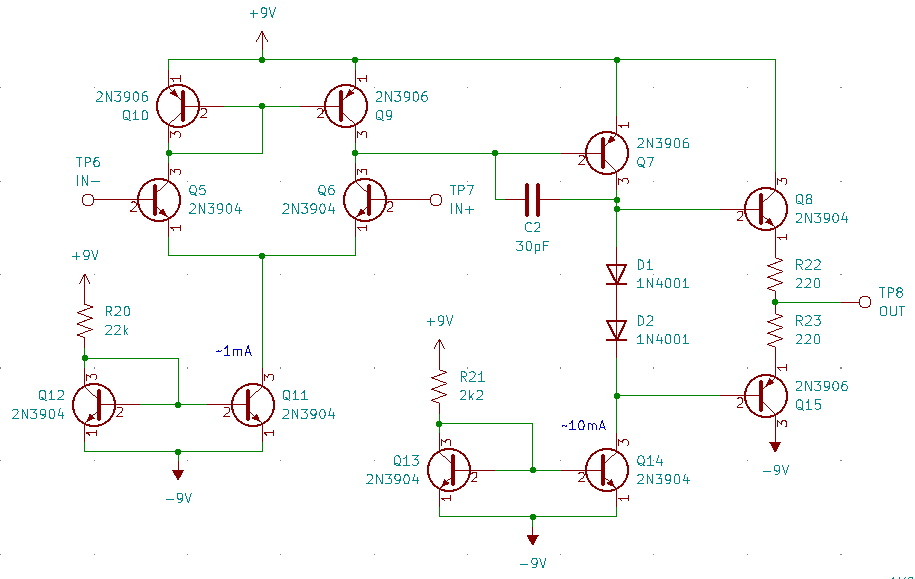
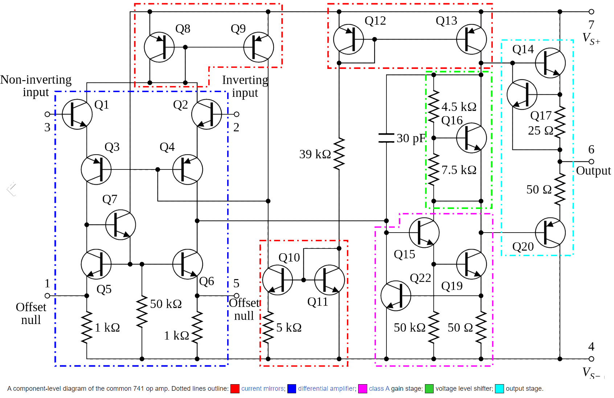
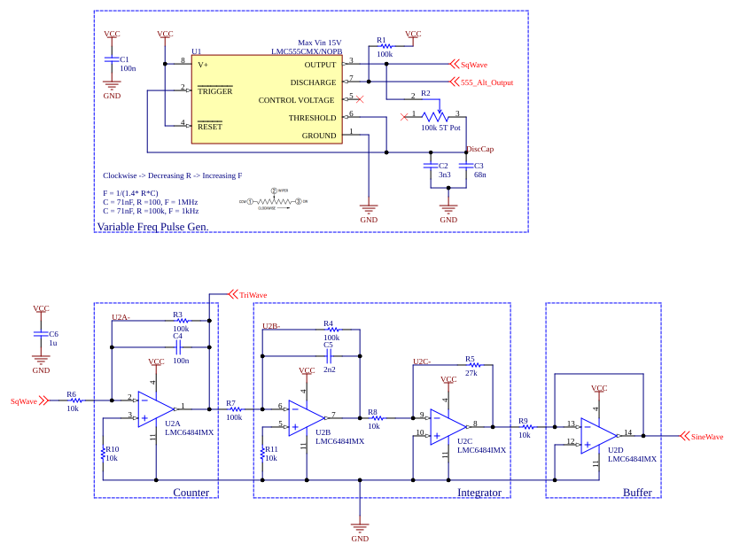
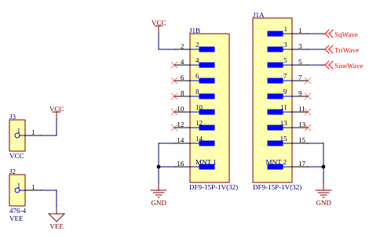

# DiscreteOpAmp

An op amp built from discrete transistors, done as a learning exercise. The board carries two discrete op-amp designs of increasing complexity alongside an IC op amp for comparison, and a companion function-generator board makes test signals to drive them. The LM741's internal schematic is kept alongside as the reference for where the designs are heading. Designed in Altium Designer 23.10.

The schematic images below are rendered straight from the `.SchDoc` files. For every sheet in one page, open [`DiscreteOpAmp_Schematics.html`](DiscreteOpAmp_Schematics.html) in a browser (download it first; GitHub shows its source rather than the page).

## The op-amp board — `DiscreteOpAmp.PrjPcb`

### Top level

`main.SchDoc` puts three op amps side by side, each brought out to its own banana jacks (IN+, IN−, OUT) so they can be driven and measured the same way: the advanced and basic discrete designs as sheet symbols, and a TLV271 IC op amp drawn directly on the sheet as the benchmark. Supplies come in as VCC and VEE. The TLV271 is wired with its output tied back to its inverting input, so its IN− jack doubles as an output monitor.

### Basic discrete op amp

`BasicDiscreteOpAmp.SchDoc` is the minimum that still behaves like an op amp, four transistors in three stages:

1. **Differential input.** Q4 and Q3 (2N3904) form a long-tailed pair sharing the 1 kΩ tail resistor R7, with 1 kΩ collector loads R1 and R2. The difference between IN+ and IN− steers current between the two sides, so the voltage at Q4's collector moves with the input difference.
2. **Gain stage.** That voltage drives the base of Q1 (2N3906) through R4. Q1 is a common-emitter PNP stage with a 200 Ω emitter resistor (R3) and a 51 kΩ collector load (R5) to VEE, and it provides most of the voltage gain. C1 (100 pF) from Q1's base to its collector is the Miller compensation capacitor: it rolls the gain off early enough that the amplifier stays stable with feedback around it.
3. **Output.** Q2 (2N3904) is an emitter follower with a 1 kΩ pull-down (R6). It gives a low output impedance but can only source current actively; it sinks only through R6.

Following the signal through confirms the polarity: raising IN+ pulls Q4's collector down, which turns Q1 on harder, which raises Q1's collector and therefore OUT.

The design follows this reference schematic, with different designators:

### Advanced discrete op amp

`AdvancedDiscreteOpAmp.SchDoc` keeps the same three-stage structure but replaces each resistor that limited the basic design with a transistor circuit:

- **Active load.** The input pair (Q9 on IN−, Q8 on IN+, 2N3904) drives a 2N3906 current mirror (Q5/Q6) instead of collector resistors. The mirror copies one side's current into the other, so both halves of the pair contribute to the output signal, and the high output impedance of Q6 gives far more gain than a 1 kΩ resistor.
- **Current-source tail.** The pair's tail is a current mirror (Q12 → Q14) set by R10 (22 kΩ) from VCC, rather than a resistor, so the bias current stays constant as the common-mode input voltage moves.
- **Current-source gain-stage load.** The gain stage Q7 (2N3906, 100 pF compensation C2) is loaded by a second mirror (Q13 → Q15) set by R11 (2.2 kΩ), about ten times the tail current. An active load again means much higher gain than the 51 kΩ resistor in the basic design.
- **Push-pull output.** The output is a complementary pair (Q10 NPN, Q11 PNP) so it can both source and sink current. The two diodes D1/D2 hold the bases about two diode drops apart, biasing both transistors slightly on (class AB) to avoid crossover distortion, and the 220 Ω emitter resistors R8/R9 stabilise the quiescent current.

The reference it follows (again with different designators, and with a 30 pF compensation cap where the schematic uses 100 pF):

### Where it's heading: the LM741

`LM741_Design.SchDoc` holds the LM741's transistor-level schematic as an embedded image; it is not drawn circuitry and is not on the PCB. The building blocks are the same ones the advanced design uses — differential input, current-mirror loads and bias, a compensated class-A gain stage, and a class-AB output — with additions such as the NPN/PNP cascode input stage (Q1–Q4), the VBE-multiplier level shifter (Q16) and output short-circuit protection.

### The board

`PCB1.PcbDoc` is about 50 × 67 mm, two layers. Fabrication outputs (Gerber X2 and NC drill, plus a zip) are in `Project Outputs for DiscreteOpAmp/`.

## The function generator — `FuncGen/FuncGen.PrjPcb`

A test-signal board that produces square, triangle and sine waves to drive the op amps.

### Signal generation

`FuncGen/Oscillator.SchDoc` builds the waveforms in a chain (the sheet's own block labels call U2A "Counter" and U2B/U2C "Integrator"; both U2A and U2B are really lossy integrators, i.e. low-pass filters):

1. **Square wave.** An LMC555 (U1) runs as an oscillator whose timing capacitor (C2 ‖ C3) charges from the output through the 100 kΩ multiturn trimmer R2. The sheet's note gives F ≈ 1/(1.4·R·C), roughly 1 kHz to 1 MHz across the trimmer's range. Its output is SqWave.
2. **Triangle.** U2A integrates the square wave (R6 in, C4 = 100 nF feedback). R3 (100 kΩ) across C4 limits the DC gain so the integrator doesn't drift into a rail. Its output is TriWave.
3. **Sine.** U2B is a low-pass stage (R7 in, R4 ‖ C5 feedback) that rounds the triangle toward a sine, and U2C is an inverting gain stage (R5/R8 = 2.7) that restores the amplitude.
4. **Buffer.** U2D is meant to buffer the result onto SineWave — but see the review notes below.

Because the filter is fixed, the sine shape is only good over a limited part of the 555's tuning range; outside it the output will look more like a triangle (low frequency) or a small, heavily filtered wave (high frequency).

### Connectors

`FuncGen/Connectors.SchDoc` is the top sheet. Supply comes in on Keystone 476 banana jacks (VCC, VEE), and the three waveforms leave on a Hirose DF9 15-position 1 mm board-to-board connector (J1), with power and ground on the other row.

The board is about 109 × 66.5 mm, two layers. Its component library is `FuncGen/FuncGen.IntLib` and its fabrication outputs are in `FuncGen/Project Outputs for FuncGen/`.

## Reference material

- `Datasheets/` — LMC555, LMC6484, the Bourns and Vishay trimmers.
- `DF9_Catalog_D31692_en-2301602.pdf` — Hirose DF9 connector catalogue.
- `Documentation/` — LM741 internal schematic, Bubba oscillator notes and the TI sine-wave generator app note (SLOA278). The two oscillator documents are background reading; neither circuit is used.

The root-level `Oscillator.SchDoc` and `Connectors.SchDoc` are not part of either project. They differ from the versions under `FuncGen/` (which the project uses), and look like leftovers from before the function generator moved into its own folder.

## Opening it

Open `DiscreteOpAmp.PrjPcb` or `FuncGen/FuncGen.PrjPcb` in Altium Designer 23.10 or later. The PCBs carry footprint parameters, which older versions drop on open.

## Status and review notes

Both boards have Gerbers generated, but neither has been confirmed as built and tested. A review of the schematics and outputs found the following.

Function generator:

- **U2D's inputs appear to be swapped.** Its + input (pin 12) is tied to GND, and its − input (pin 13) connects both to its own output and to R9. As drawn it is a follower of ground: it holds SineWave at 0 V and loads U2C through R9. For a buffer, R9 should feed pin 12 with pin 13 tied to the output.
- **The op-amp chain sits on its negative rail.** The LMC6484's V− (pin 11) and every + input go to GND, and the board's VEE jack feeds nothing on this sheet. The integrator and gain stages are inverting around GND, so their outputs try to swing below their negative supply and will clip. Either power U2 from VEE or bias the + inputs at mid-supply (with AC coupling from the 555).
- **The committed DRC report shows open issues.** The report from 2023-10-23 16:36 lists 107 rule violations, including 2 short circuits and 5 unrouted nets. The Gerbers were generated about an hour later, so these may have been fixed, but no newer DRC report confirms it. Re-run DRC before fabricating.

Op-amp board:

- **The Gerbers are older than the schematics.** They were generated on 2023-10-20; the basic and advanced circuits were completed on 2023-10-21 and the project was reorganised into a hierarchy on 2024-02-23. Sync the PCB and regenerate before ordering.
- **The top sheet is not annotated.** Its jacks and the TLV271 still carry `J?` and `U?` designators.
- **`AdvancedDiscreteOpAmp.SchDoc` has a stray wire off the sheet**, a short vertical segment at about X = −1000 (left of the sheet edge). It does not appear to connect to anything and can probably be deleted.

No simulation results, measurements or BOM are in the repo yet.

## History

- 2023-10-20 — project started; first PCB outputs.
- 2023-10-21 — basic and advanced discrete op amps complete.
- 2023-10-23 — function generator developed.
- 2023-10-24 — Gerbers generated, documentation added.
- 2023-11-08 — Altium history/preview/log folders git-ignored.
- 2024-02-23 — schematics moved into a hierarchy under `main.SchDoc`; LM741 reference sheet added.
